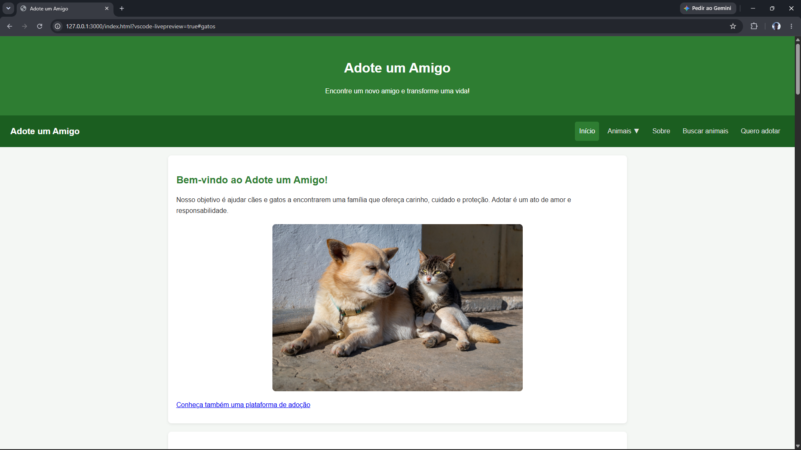

# 🐾 Projeto Integrador — Adote um Amigo

## 1. Sobre o projeto

O **Adote um Amigo** é um projeto desenvolvido com o tema de adoção responsável de animais.
A página é voltada para pessoas que desejam adotar cães e gatos e conhecer animais disponíveis para adoção.
O objetivo é facilitar o acesso às informações dos animais e aproximar os animais de possíveis novos tutores.
O projeto também permite cadastrar novos animais, pesquisar, filtrar e demonstrar interesse em uma adoção.

## 2. Tecnologias utilizadas

- **HTML5:** estruturação e organização do conteúdo da página.
- **CSS3:** estilização, cores, layout, responsividade, Flexbox e Grid.
- **JavaScript:** funcionalidades, validações, cálculos, busca, filtros, cadastro e manipulação do DOM.
- **SVG:** criação de gráfico ilustrativo sobre os animais disponíveis.
- **Visual Studio Code:** editor utilizado no desenvolvimento.
- **Git e GitHub:** controle de versão e armazenamento do projeto.

## 3. Capturas de tela

As imagens abaixo apresentam o projeto em diferentes tamanhos de tela.

### Versão desktop



### Versão celular


## 4. Estrutura de pastas

A organização dos arquivos do projeto está representada abaixo:

```text
projeto-integrador-frontend-joao-manoel/
│
├── .gitignore
├── README.md
├── index.html
│
├── css/
│   ├── reset.css
│   └── style.css
│
├── js/
│   └── script.js
│
└── assets/
    │
    ├── images/
    │   ├── capa.jpg
    │   ├── animais.jpg
    │   ├── print-desktop.png
    │   └── print-celular.jpeg
    │
    ├── videos/
    │   ├── video.mp4
    │   └── video.webm
    │
    └── subtitles/
        └── legendas.vtt
```

## 5. Como executar o projeto

Para executar o projeto, siga os passos:

1. Acesse o repositório no GitHub.
2. Baixe ou clone o repositório para o computador.
3. Abra a pasta do projeto no Visual Studio Code.
4. Localize o arquivo `index.html`.
5. Abra o arquivo diretamente no navegador ou utilize a extensão Live Server.
6. Para utilizar o Live Server, clique com o botão direito no `index.html` e selecione **Open with Live Server**.

Não é necessário instalar bibliotecas ou frameworks, pois o projeto utiliza HTML, CSS e JavaScript puros.

## 6. Mapa dos requisitos

A tabela apresenta os arquivos e as linhas em que os requisitos solicitados nas atividades foram implementados.

### 6.1 Repositório e organização

| Requisito | Arquivo e localização |
|---|---|
| Repositório público | GitHub — repositório principal |
| Organização das pastas | Estrutura do repositório |
| Arquivos com caminhos relativos | `index.html` — linhas 9–10, 73 e 232–240 |
| Histórico de commits | GitHub — aba Commits |
| Branches e Pull Requests | GitHub — abas Branches e Pull requests |
| Versão final na main | GitHub — branch `main` |
| Documentação | `README.md` |

### 6.2 HTML

| Requisito | Arquivo e localização |
|---|---|
| Estrutura HTML5 e idioma | `index.html` — linhas 1–7 |
| Meta charset e viewport | `index.html` — linhas 4–5 |
| Título e H1 | `index.html` — linhas 7 e 16–19 |
| Lista com itens relacionados ao tema | `index.html` — linhas 98–103 |
| Tabela com dados sobre cuidados | `index.html` — linhas 159–187 |
| Link externo seguro | `index.html` — linhas 77–83 |
| Imagem com texto alternativo | `index.html` — linhas 72–75 |
| Header e navegação | `index.html` — linhas 15–57 |
| Main e sections | `index.html` — linhas 59–60 e 63–387 |
| Footer | `index.html` — linhas 390–397 |
| Formulário de cadastro de animais | `index.html` — linhas 275–311 |
| Formulário de adoção | `index.html` — linhas 313–385 |
| Labels associados aos campos | `index.html` — linhas 284–303 e 324–379 |
| Fieldset e legend | `index.html` — linhas 284–285, 324–325 e 359–360 |
| Campos obrigatórios | `index.html` — linhas 286–303 e 326–355 |
| Validação com pattern e min/max | `index.html` — linhas 346–347 e 351–355 |
| Vídeo com dois formatos | `index.html` — linhas 219–246 |
| Preload justificado em comentário | `index.html` — linhas 228–233 |
| Poster e legendas | `index.html` — linhas 232 e 237–242 |
| Gráfico SVG com descrição acessível | `index.html` — linhas 190–217 |
| Botão com aria-pressed | `index.html` — linhas 261–266 |
| Script com defer | `index.html` — linha 400 |

### 6.3 CSS

| Requisito | Arquivo e localização |
|---|---|
| Reset CSS e box-sizing | `css/reset.css` — linhas 0–8 |
| Variáveis CSS no :root | `css/style.css` — linhas 4–14 |
| Classes reutilizáveis | `css/style.css` — linhas 65–72, 197–235 e 290–309 |
| Seletor de ID | `css/style.css` — linhas 265–280 e 285–288 |
| Combinador descendente | `css/style.css` — linhas 60–63 |
| Box model | `css/style.css` — linhas 203–209 e 332–337 |
| Estados dos links | `css/style.css` — linhas 124–145 |
| Estilização da tabela | `css/style.css` — linhas 241–260 |
| Estilização das listas | `css/style.css` — linhas 74–81 e 474–476 |
| Font-size em rem e justificativa | `css/style.css` — linhas 465–466 e demais declarações de fonte |
| Navbar com Flexbox | `css/style.css` — linhas 86–95 e 104–111 |
| Estado ativo do menu | `css/style.css` — linhas 147–151 |
| Dropdown com hover | `css/style.css` — linhas 153–174 |
| Navbar sticky | `css/style.css` — linhas 86–95 |
| Botão hambúrguer | `css/style.css` — linhas 183–191 |
| Grid responsivo | `css/style.css` — linhas 197–202 |
| Pseudo-classe estrutural | `css/style.css` — linhas 212–215 |
| Animação com transform | `css/style.css` — linhas 217–221 e 468–473 |
| Responsividade para celular | `css/style.css` — linhas 417–464 |
| Responsividade do SVG | `css/style.css` — linhas 265–271 |

### 6.4 JavaScript

| Requisito | Arquivo e localização |
|---|---|
| Comentário de planejamento | `js/script.js` — linhas 0–18 |
| Array de animais com propriedades | `js/script.js` — linhas 20–62 |
| Estruturas if, else if e else | `js/script.js` — linhas 85–94 |
| Estrutura switch | `js/script.js` — linhas 96–115 |
| Estrutura for...of e acumulador | `js/script.js` — linhas 117–164 |
| Estrutura while | `js/script.js` — linhas 534–562 |
| Funções de processamento e classificação | `js/script.js` — linhas 79–115 |
| Uso de const e let e escopo local | `js/script.js` — linhas 79–94 e 138–164 |
| Conversão explícita com Number() | `js/script.js` — linhas 387–390 e 503–510 |
| Retorno com return | `js/script.js` — linhas 80–94 e 117–135 |
| Método map() | `js/script.js` — linhas 166–178 |
| Método filter() | `js/script.js` — linhas 276–296 |
| Método reduce() | `js/script.js` — linhas 234–248 |
| createElement e textContent | `js/script.js` — linhas 180–232 |
| Inserção dos elementos no DOM | `js/script.js` — linhas 221–229 e 301–304 |
| Classes CSS nos resultados | `js/script.js` — linhas 199–205 |
| Delegação de eventos | `js/script.js` — linhas 310–349 |
| Busca de animais | `js/script.js` — linhas 370–373 e 628–630 |
| Filtro de disponibilidade | `js/script.js` — linhas 352–367 |
| Atualização do resumo | `js/script.js` — linhas 234–261 e 306 |
| Acessibilidade do resumo com aria-live | `index.html` — linhas 268–270 |
| Controle de aria-pressed | `js/script.js` — linhas 352–367 |
| Menu com aria-expanded | `js/script.js` — linhas 449–457 |
| Navegação por teclado e Escape | `js/script.js` — linhas 460–472 e 643–650 |
| Cadastro de novos animais | `js/script.js` — linhas 376–422 |
| Inicialização dos eventos | `js/script.js` — linhas 621–668 |

## 7. Autor

- **Nome:** João Manoel Andrade da Silva
- **RGM:** 50006673
- **Curso:** Análise e Desenvolvimento de Sistemas

---

Projeto desenvolvido como parte das atividades acadêmicas da disciplina de Desenvolvimento Front-end para Web.