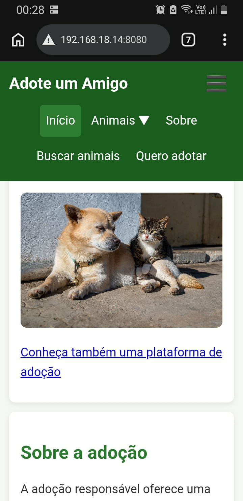

# 🐾 Adote um Amigo

## 1. Sobre o projeto

O **Adote um Amigo** é um projeto desenvolvido com o tema de adoção responsável de animais.  
A página é voltada para pessoas que desejam adotar cães e gatos e conhecer animais que estão disponíveis.  
O objetivo é facilitar o acesso às informações dos animais, incentivar a adoção responsável e aproximar os animais de possíveis novos tutores.  
O projeto também permite cadastrar animais e demonstrar interesse em uma adoção.

## 2. Tecnologias utilizadas

As seguintes tecnologias foram utilizadas no desenvolvimento:

- **HTML5:** estruturação e organização do conteúdo da página.
- **CSS3:** estilização, cores, layout, responsividade, Flexbox e Grid.
- **JavaScript puro:** funcionalidades, validações, busca, filtros, cadastro e manipulação do DOM.
- **Visual Studio Code:** editor utilizado para desenvolver o projeto.
- **Git e GitHub:** controle de versão e armazenamento do código.

## 3. Capturas de tela

As imagens abaixo mostram a página do projeto em diferentes dispositivos.

### Versão desktop


### Versão celular




## 4. Estrutura de pastas

A organização principal dos arquivos do projeto está representada abaixo:

```text
projeto-integrador-frontend-joao-manoel/
│
├── .gitignore
├── README.md
├── index.html
│
├── css/
│   ├── reset.css
│   └── style.css
│
├── js/
│   └── script.js
│
└── assets/
    │
    ├── images/
    │   ├── capa.jpg
    │   ├── animais.jpg
    │   ├── print-desktop.png
    │   └── print-celular.jpeg
    │
    ├── videos/
    │   ├── video.mp4
    │   └── video.webm
    │
    └── subtitles/
        └── legendas.vtt
````

## 5. Como executar o projeto

Para visualizar o projeto, siga os passos:

1. Baixe ou clone o repositório do GitHub.
2. Abra a pasta do projeto no Visual Studio Code.
3. Localize o arquivo `index.html`.
4. Abra o arquivo diretamente no navegador ou utilize a extensão **Live Server**.
5. Caso utilize o Live Server, clique com o botão direito no `index.html` e selecione **Open with Live Server**.

Não é necessário instalar bibliotecas ou frameworks para executar as funcionalidades principais, pois o projeto utiliza JavaScript puro.

## 6. Mapa dos requisitos

A tabela apresenta onde estão implementados os principais requisitos de desenvolvimento do projeto.

| Requisito | Arquivo e local de implementação |
|---|---|
| Estrutura HTML5 | `index.html` — estrutura principal |
| HTML semântico | `index.html` — `header`, `main`, `section` e `footer` |
| Formulários | `index.html` — formulários de cadastro e adoção |
| Imagens e conteúdo | `index.html` — seção de animais |
| Vídeo e legendas | `index.html` — seção de mídia |
| Reset CSS | `css/reset.css` — regras de reset |
| Variáveis CSS | `css/style.css` — seletor `:root` |
| Classes e seletores | `css/style.css` — estilos dos componentes |
| Box model | `css/style.css` — cards, botões e formulários |
| Flexbox | `css/style.css` — barra de navegação |
| CSS Grid | `css/style.css` — grade de animais |
| Dropdown e menu mobile | `css/style.css` e `js/script.js` — menu de navegação |
| Array de animais | `js/script.js` — array `animais` |
| Funções e parâmetros | `js/script.js` — funções de cálculo e classificação |
| Métodos de array | `js/script.js` — `map()`, `filter()` e `reduce()` |
| Manipulação do DOM | `js/script.js` — `createElement()`, `textContent` e `append()` |
| Atualização da lista | `js/script.js` — função `desenhar()` |
| Delegação de eventos | `js/script.js` — função `tratarCliqueLista()` |
| Busca por nome e espécie | `js/script.js` — função `desenhar()` |
| Filtro de disponibilidade | `js/script.js` — função `alternarFiltro()` |
| Cadastro de animais | `js/script.js` — função `adicionarAnimal()` |
| Resumo dos animais | `js/script.js` — funções `calcularResumo()` e `atualizarResumo()` |
| Acessibilidade do menu | `index.html` e `js/script.js` — atributos ARIA e controle por teclado |


## 7. Autor

- **Nome:** [João Manoel Andrade da Silva]
- **RGM:** [50006673]
- **Curso:** [Análise e Desenvolvimento de Sistemas]

---

Projeto desenvolvido como parte das atividades acadêmicas de Desenvolvimento Front-end para Web.
